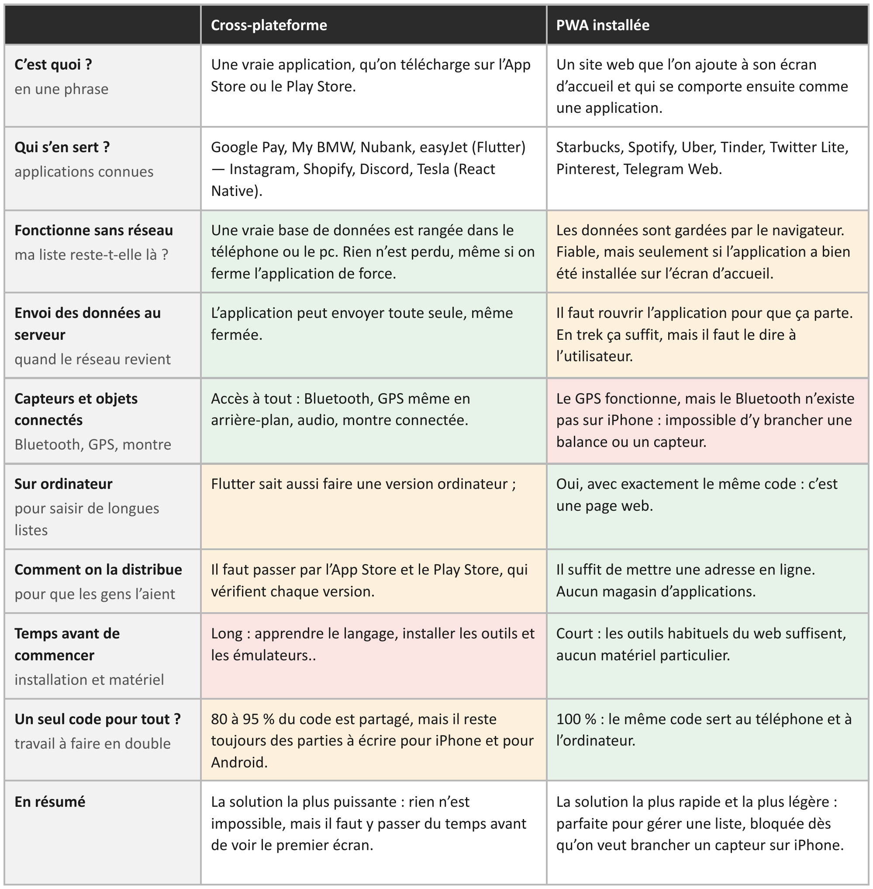

# Comparatif technologique

## Les deux approches étudiées

Avant de commencer le développement, il fallait choisir sous quelle forme l'application allait être distribuée. Deux grandes approches permettent d'avoir une seule base de code pour le téléphone et l'ordinateur :

- **Cross-plateforme :** une vraie application native, développée avec un framework comme Flutter ou React Native, et téléchargée depuis l'App Store ou le Play Store.
- **PWA installée :** un site web que l'on ajoute à son écran d'accueil et qui se comporte ensuite comme une application.

Nous les avons comparées sur les critères qui comptent pour nos [personas](personas.md) : le hors ligne, la synchronisation, l'usage sur ordinateur, la distribution et le temps de mise en place.

## Tableau comparatif

Les cases en vert sont les points forts, en orange les points à surveiller, et en rouge les points bloquants.

{ width="800" .center }

## Version texte

|  | Cross-plateforme | PWA installée |
| --- | --- | --- |
| **C'est quoi ?** en une phrase | Une vraie application, qu'on télécharge sur l'App Store ou le Play Store. | Un site web que l'on ajoute à son écran d'accueil et qui se comporte ensuite comme une application. |
| **Qui s'en sert ?** applications connues | Google Pay, My BMW, Nubank, easyJet (Flutter) ; Instagram, Shopify, Discord, Tesla (React Native). | Starbucks, Spotify, Uber, Tinder, Twitter Lite, Pinterest, Telegram Web. |
| **Fonctionne sans réseau** ma liste reste-t-elle là ? | Une vraie base de données est rangée dans le téléphone ou le PC. Rien n'est perdu, même si on ferme l'application de force. | Les données sont gardées par le navigateur. Fiable, mais seulement si l'application a bien été installée sur l'écran d'accueil. |
| **Envoi des données au serveur** quand le réseau revient | L'application peut envoyer toute seule, même fermée. | Il faut rouvrir l'application pour que ça parte. En trek ça suffit, mais il faut le dire à l'utilisateur. |
| **Capteurs et objets connectés** Bluetooth, GPS, montre | Accès à tout : Bluetooth, GPS même en arrière-plan, audio, montre connectée. | Le GPS fonctionne, mais le Bluetooth n'existe pas sur iPhone : impossible d'y brancher une balance ou un capteur. |
| **Sur ordinateur** pour saisir de longues listes | Flutter sait aussi faire une version ordinateur. | Oui, avec exactement le même code : c'est une page web. |
| **Comment on la distribue** pour que les gens l'aient | Il faut passer par l'App Store et le Play Store, qui vérifient chaque version. | Il suffit de mettre une adresse en ligne. Aucun magasin d'applications. |
| **Temps avant de commencer** installation et matériel | Long : apprendre le langage, installer les outils et les émulateurs. | Court : les outils habituels du web suffisent, aucun matériel particulier. |
| **Un seul code pour tout ?** travail à faire en double | 80 à 95 % du code est partagé, mais il reste toujours des parties à écrire pour iPhone et pour Android. | 100 % : le même code sert au téléphone et à l'ordinateur. |
| **En résumé** | La solution la plus puissante : rien n'est impossible, mais il faut y passer du temps avant de voir le premier écran. | La solution la plus rapide et la plus légère : parfaite pour gérer une liste, bloquée dès qu'on veut brancher un capteur sur iPhone. |
