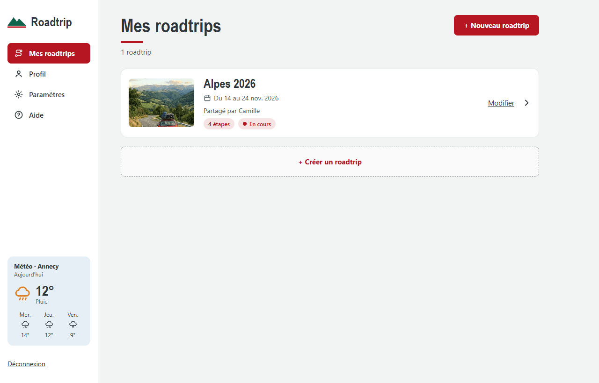

# Les droits de chacun

Chaque personne qui a accès à un roadtrip a l'un des trois rôles suivants.

| Ce que la personne peut faire | Propriétaire | Peut modifier | Peut regarder |
|---|:---:|:---:|:---:|
| Voir les étapes, les dates, les hébergements et la carte | ✓ | ✓ | ✓ |
| Ajouter, modifier ou supprimer des étapes | ✓ | ✓ | — |
| Ajouter, modifier ou supprimer des hébergements, marquer comme payé | ✓ | ✓ | — |
| Modifier le nom et les dates du roadtrip | ✓ | ✓ | — |
| Partager le roadtrip et gérer les droits | ✓ | — | — |
| Supprimer le roadtrip | ✓ | — | — |

- Le **propriétaire** est la personne qui a créé le roadtrip. Il y en a un seul par roadtrip.
- **Peut modifier** convient à un compagnon de voyage qui organise avec vous.
- **Peut regarder** convient à quelqu'un qui veut seulement suivre le voyage.

Un roadtrip qu'on vous a partagé porte la mention « Partagé par *Prénom* » dans votre liste :

{ .capture loading=lazy }

## Ce que voit une personne en « Peut regarder »

- Dans **Mes roadtrips**, le roadtrip porte les mentions **« Partagé par *Prénom* »** et **Lecture seule**.
- Les boutons pour ajouter, modifier ou supprimer n'apparaissent pas.
- Si elle ouvre quand même une page de modification, l'application la ramène au roadtrip avec le message : « Vous pouvez seulement consulter ce roadtrip. »

!!! info "Si vos droits changent"
    Si le propriétaire change votre droit pendant que vous travaillez, l'application affiche « Vos droits sur ce roadtrip ont changé. » Rechargez la page.
