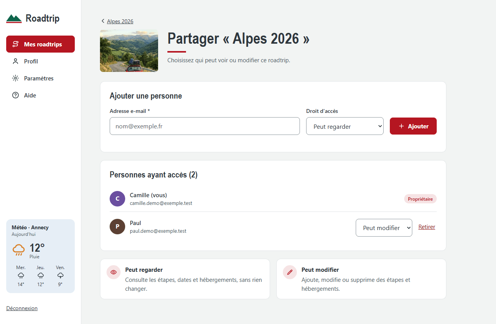

# Partager un roadtrip

Vous pouvez donner accès à votre roadtrip aux personnes qui voyagent avec vous. Elles le verront dans leur propre liste **Mes roadtrips**.

!!! warning "Avant de commencer"
    - Seul le **propriétaire** du roadtrip peut le partager.
    - La personne doit **déjà avoir un compte Roadtrip**. Demandez-lui d'en [créer un](../premiers-pas/creer-un-compte.md) avec son adresse e-mail. Aucune invitation n'est envoyée par e-mail.

## Ajouter une personne

{ .capture loading=lazy }

1. Ouvrez le roadtrip et cliquez sur Partager.
2. Dans **Ajouter une personne**, saisissez son **adresse e-mail**.
3. Choisissez son **droit d'accès** :
    - **Peut regarder** (choix par défaut) : elle consulte tout sans rien changer ;
    - **Peut modifier** : elle peut ajouter, modifier ou supprimer des étapes et des hébergements.
4. Cliquez sur Ajouter.

Le message « *Prénom* peut maintenant regarder « *nom* ». » confirme l'ajout.

## Messages possibles

| Message | Que faire |
|---|---|
| « Aucun compte RoadsPlanner avec cet e-mail. » | La personne n'a pas encore de compte, ou l'adresse est différente. Demandez-lui de s'inscrire, puis réessayez. |
| « *Prénom* a déjà accès à ce roadtrip. » | Rien à faire : elle est déjà dans la liste. |
| « Vous êtes déjà propriétaire de ce roadtrip. » | Vous avez saisi votre propre adresse. |

## Changer le droit d'une personne

Dans **Personnes ayant accès**, changez la liste à côté de son nom (**Peut regarder** ou **Peut modifier**).
Le changement est enregistré immédiatement.

## Retirer l'accès

1. Cliquez sur **Retirer** à côté de la personne.
2. Confirmez avec Retirer l'accès.

La personne ne voit plus le roadtrip.
