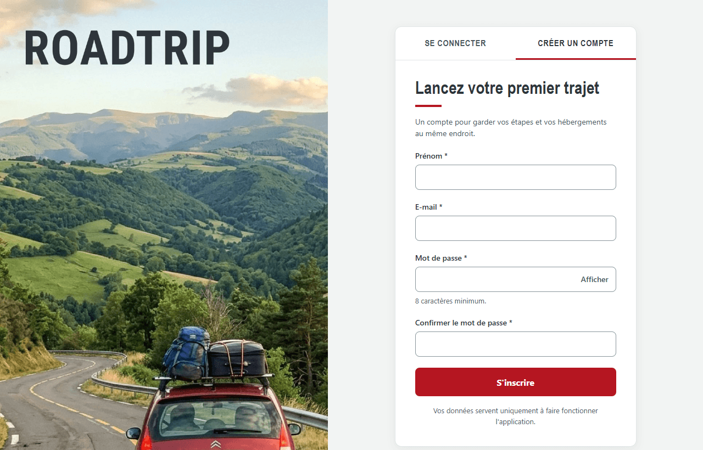

# Créer un compte

Un compte vous permet de retrouver vos roadtrips sur n'importe quel appareil et de les partager. Il est gratuit.

## Étapes

1. Ouvrez l'application. Si vous n'êtes pas connecté, la page de connexion s'affiche.
2. En haut du formulaire, cliquez sur l'onglet Créer un compte.
   Le titre devient **« Lancez votre premier trajet »**.
3. Remplissez les quatre champs :

    | Champ | Ce qu'il faut mettre |
    |---|---|
    | **Prénom** | Votre prénom, tel que les autres le verront quand vous partagerez un roadtrip (50 caractères au plus). |
    | **E-mail** | Votre adresse e-mail, par exemple `nom@exemple.fr`. Elle sert à vous connecter. |
    | **Mot de passe** | Au moins **8 caractères**. Le bouton Afficher permet de vérifier ce que vous tapez. |
    | **Confirmer le mot de passe** | Le même mot de passe, une seconde fois. |

4. Cliquez sur S'inscrire.

{ .capture loading=lazy }

Vous êtes **connecté tout de suite** et vous arrivez sur la page **Mes roadtrips**, encore vide. La suite : [Créer un roadtrip](../roadtrip/creer.md).

!!! info "Vos données"
    Vos informations servent uniquement à faire fonctionner l'application.

## Si un message rouge apparaît

| Message | Que faire |
|---|---|
| « Indiquez votre prénom. » | Le prénom est obligatoire. |
| « Indiquez une adresse e-mail valide, par exemple nom@exemple.fr. » | Vérifiez qu'il y a bien un `@` et un point dans l'adresse. |
| « Le mot de passe doit contenir au moins 8 caractères. » | Allongez votre mot de passe. |
| « Les deux mots de passe ne correspondent pas. » | Retapez le même mot de passe dans les deux champs. |
| « Un compte existe déjà avec cet e-mail. » | Vous avez déjà un compte : cliquez sur **Se connecter avec cet e-mail**. |

!!! tip "Conseil"
    Les champs marqués d'une étoile **\*** sont obligatoires. S'il manque quelque chose, un bandeau en haut du formulaire indique combien de champs sont à compléter.
