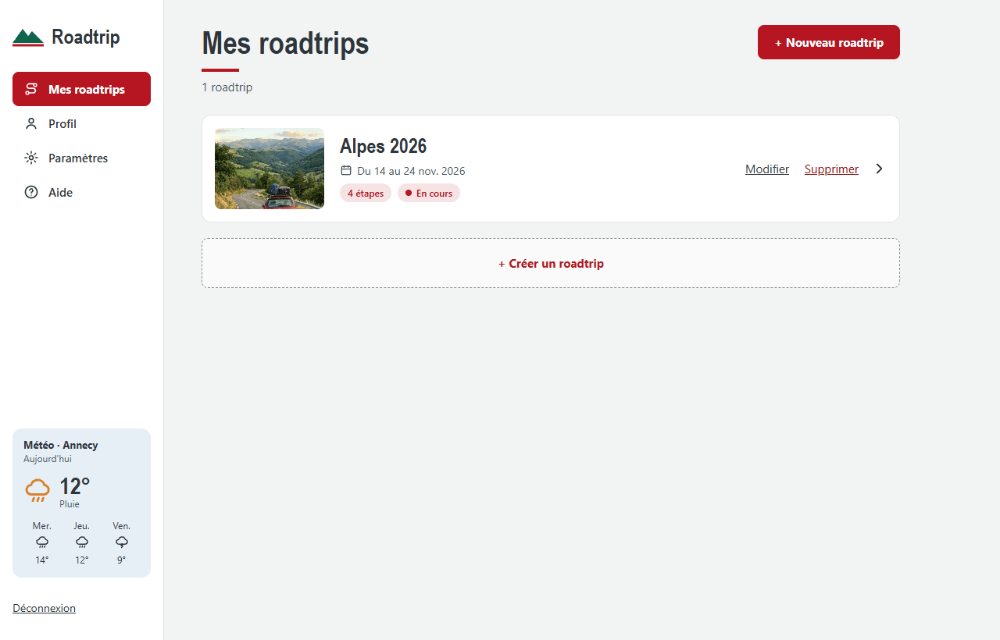
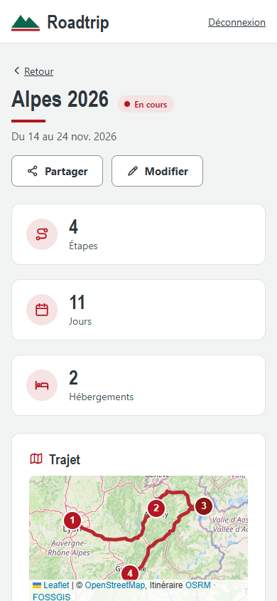

# Découvrir l'écran

Une fois connecté, l'écran est toujours organisé de la même façon.

{ .capture loading=lazy }

## Le menu de gauche

| Élément | À quoi il sert |
|---|---|
| **Logo Roadtrip** | Revient à la liste de vos roadtrips. |
| **Mes roadtrips** | La liste de tous vos voyages (les vôtres et ceux qu'on a partagés avec vous). |
| **Profil**, **Paramètres**, **Aide** | Pas encore disponibles : ces pages affichent « Bientôt disponible ». |
| **Carte météo** | La météo de l'étape en cours (voir plus bas). |
| **Déconnexion** | Vous déconnecte. |

!!! info "Sur téléphone"
    Sur un petit écran, le menu de gauche est remplacé par un en-tête compact : le logo (qui ramène à vos roadtrips) et le lien **Déconnexion**. Le contenu s'affiche en une seule colonne.

    { .capture loading=lazy width="300" }

## La carte météo

En bas du menu, une petite carte affiche **« Météo · *Ville* »** : la température du jour et les trois jours suivants.

- La ville choisie est celle de l'étape **en cours aujourd'hui**, sinon la **prochaine**, sinon la **première**.
- Quand vous êtes dans un roadtrip, c'est la météo de ce roadtrip ; ailleurs, celle de votre premier roadtrip.
- Si vous n'avez encore aucune étape placée sur la carte : « Ajoutez une étape pour voir la météo de votre destination. »
- Si le service météo ne répond pas : « Météo indisponible pour le moment. »

!!! tip "La météo ne s'affiche pas pour une ville ?"
    La météo n'est disponible que pour les étapes dont la ville a été **choisie dans la liste de suggestions**. Voir [Ajouter une étape](../roadtrip/ajouter-une-etape.md#la-ville).

## La page « Mes roadtrips »

C'est votre page d'accueil. Chaque roadtrip y apparaît sous forme de carte avec :

- son **nom** (cliquez dessus pour l'ouvrir) et ses **dates**, par exemple « Du 3 au 10 juil. 2026 » ;
- le **nombre d'étapes** ;
- son **statut** : *Brouillon* (pas encore d'étape), *À venir*, *En cours* ou *Terminé* ;
- « **Partagé par** *Prénom* » si quelqu'un vous l'a partagé, et **Lecture seule** si vous pouvez seulement le regarder ;
- les liens **Modifier** et **Supprimer** quand vous en avez le droit.

Les voyages en cours et à venir sont en haut, les voyages terminés en bas.

## Les messages de l'application

- Un **message vert ou gris** en haut de la page confirme une action (« Roadtrip créé. », « Étape ajoutée »…).
- Un **message rouge** sous un champ explique ce qu'il faut corriger.
- « **Chargement…** » s'affiche pendant que les informations arrivent.
