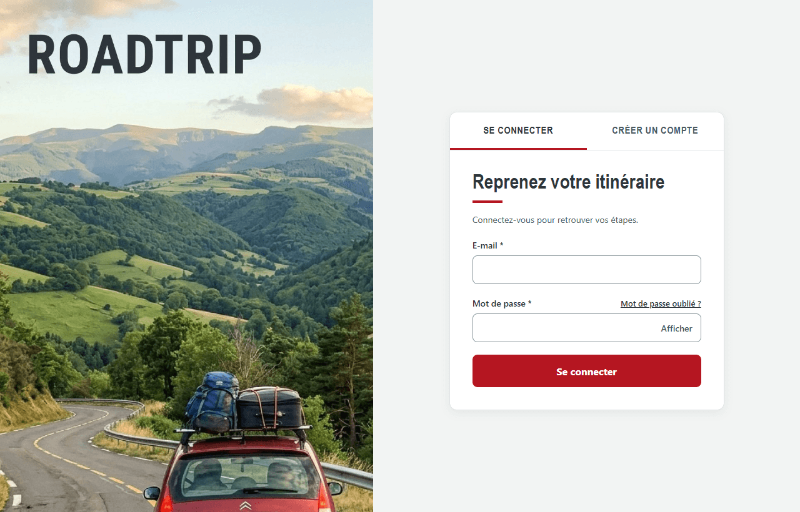

# Se connecter et se déconnecter

## Se connecter

1. Ouvrez l'application : la page **« Reprenez votre itinéraire »** s'affiche.
2. Saisissez votre **E-mail** et votre **Mot de passe**.
3. Cliquez sur Se connecter.

{ .capture loading=lazy }

Vous arrivez sur **Mes roadtrips**. Si vous aviez ouvert un lien vers une page précise (par exemple un roadtrip partagé), l'application vous y ramène après la connexion.

### En cas d'erreur

- **« E-mail ou mot de passe incorrect »** : vérifiez l'adresse et le mot de passe (attention aux majuscules). Le champ mot de passe est vidé, retapez-le.
- **« Trop de tentatives. Réessayez dans 15 minutes. »** : après 5 essais ratés, la connexion est bloquée 15 minutes pour protéger votre compte. Patientez puis réessayez.

!!! warning "Mot de passe oublié"
    Le lien **Mot de passe oublié ?** existe, mais la réinitialisation n'est **pas encore disponible** : la page indique « Réinitialisation disponible dans une prochaine version. » et aucun e-mail n'est envoyé. Notez bien votre mot de passe.

## Rester connecté

Vous restez connecté sur cet appareil. Si votre session expire, l'application affiche **« Votre session a expiré. Reconnectez-vous. »** : il suffit de vous reconnecter.

## Se déconnecter

En bas du menu de gauche, cliquez sur Déconnexion.
Vous revenez sur la page de connexion avec le message **« Vous êtes déconnecté. »**

!!! tip "Sur un ordinateur partagé"
    Pensez toujours à vous déconnecter avant de partir.
