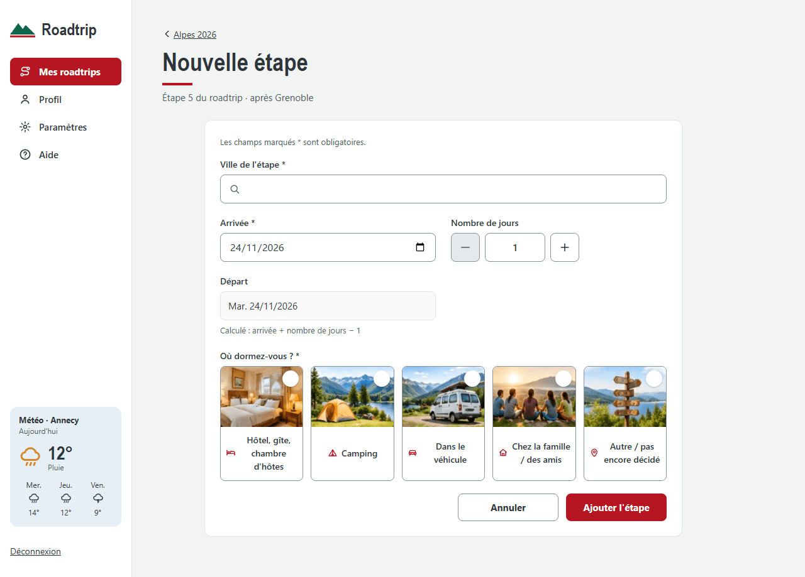

# Ajouter une étape

Une **étape** est une ville où vous vous arrêtez : vous y arrivez un jour et vous y restez un certain nombre de jours. Les étapes se suivent dans l'ordre des dates.

## Étapes

1. Ouvrez votre roadtrip depuis **Mes roadtrips**.
2. Cliquez sur + Ajouter une étape.
   Le sous-titre vous rappelle où se place l'étape : « Première étape du roadtrip » ou « Étape 2 du roadtrip · après Lyon ».
3. Remplissez le formulaire **Nouvelle étape** (détails ci-dessous).
4. Cliquez sur Ajouter l'étape
   (ou sur Continuer vers l'hébergement si vous avez choisi l'hôtel).

Le message **« Étape ajoutée »** confirme l'enregistrement.

{ .capture loading=lazy }

## La ville

Dans **Ville de l'étape**, tapez au moins **3 lettres** : une liste de suggestions apparaît (5 villes au plus, issues d'OpenStreetMap).

**Choisissez de préférence une ville dans la liste.**

!!! warning "Pourquoi choisir dans la liste ?"
    Vous pouvez aussi garder votre propre saisie, par exemple si la ville n'est pas proposée (« Aucune suggestion : vous pouvez garder votre saisie. »).
    Mais une ville tapée à la main **n'a pas de position** : l'étape **n'apparaîtra pas sur la carte** et la **météo** ne sera pas disponible pour elle.

Le bouton **✕** efface ce que vous avez tapé.

## Les dates

| Champ | Ce qu'il faut savoir |
|---|---|
| **Arrivée** | Le jour où vous arrivez. Elle est pré-remplie avec le jour de départ de l'étape précédente. |
| **Nombre de jours** | Combien de jours vous restez (de 1 à 365). Utilisez les boutons **−** et **+**. |
| **Départ** | Calculé automatiquement : **arrivée + nombre de jours − 1**. |

!!! example "Exemple"
    Arrivée le **16 octobre**, **3 jours** → départ le **18 octobre**.
    Avec **1 jour**, vous repartez le jour même de votre arrivée.

L'étape doit rester **dans les dates du roadtrip** et ne pas **chevaucher** une autre étape. Sinon, un message l'indique, par exemple : « Ces dates chevauchent l'étape 2 · Annecy (16–19 oct.). »

## Où dormez-vous ?

Choisissez l'une des **5 cartes** :

- Hôtel, gîte, chambre d'hôtes
- Camping
- Dans le véhicule
- Chez la famille / des amis
- Autre / pas encore décidé

Chaque choix demande des informations différentes : tout est expliqué dans [Choisir où dormir](hebergement.md).

## Quitter sans enregistrer

Si vous cliquez sur Annuler après avoir commencé à remplir le formulaire, l'application demande **« Abandonner cette étape ? »**.
Abandonner efface ce que vous avez saisi. Annuler vous laisse continuer.
