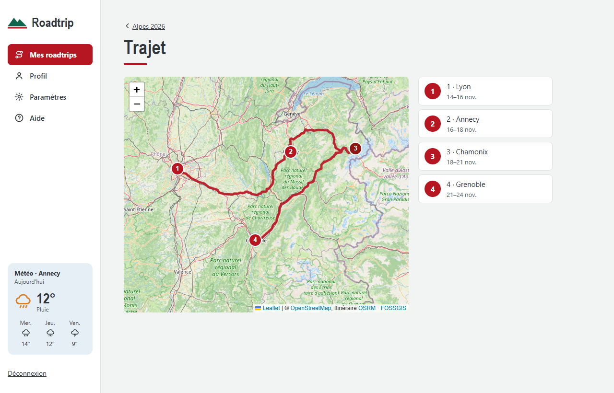

# Voir le trajet sur la carte

La page **Trajet** affiche toutes vos étapes sur une carte, reliées par la route.

## Ouvrir la carte

Vous avez deux possibilités :

- sur le tableau de bord, cliquez sur Voir sur la carte ;
- sur la page d'une étape, cliquez sur Voir sur la carte pour centrer la carte sur cette étape.

## Ce que vous voyez

{ .capture loading=lazy }

- Chaque étape est un **rond numéroté**, dans l'ordre du voyage.
- Le trait rouge suit **les routes** entre les étapes. Pendant le chargement, ou si le calcul d'itinéraire ne répond pas, les étapes sont reliées par des lignes droites.
- Cliquez sur un rond pour afficher **« Étape N · Ville »**.
- À côté de la carte, la **liste des étapes** avec leurs dates. Cliquez sur une étape pour centrer la carte dessus.

Pour vous déplacer sur la carte :

- utilisez les boutons **+** et **−** ou la molette pour zoomer ;
- faites glisser la carte pour la déplacer.

## Une étape n'apparaît pas ?

Sous la carte, un message peut indiquer par exemple : **« 1 étape sans position n'apparaît pas sur la carte : Pralognan. »**

Cela arrive quand la ville a été **tapée à la main** au lieu d'être choisie dans les suggestions. Pour corriger :

1. ouvrez l'étape et cliquez sur Modifier ;
2. effacez la ville et retapez-la ;
3. **choisissez-la dans la liste** ;
4. enregistrez.

!!! info "Carte indisponible"
    Si le fond de carte ne se charge pas (problème de réseau), l'application affiche « Carte indisponible pour le moment. » et liste vos étapes dans l'ordre.

!!! note "Sources"
    Fond de carte © OpenStreetMap. Itinéraire calculé par OSRM.
