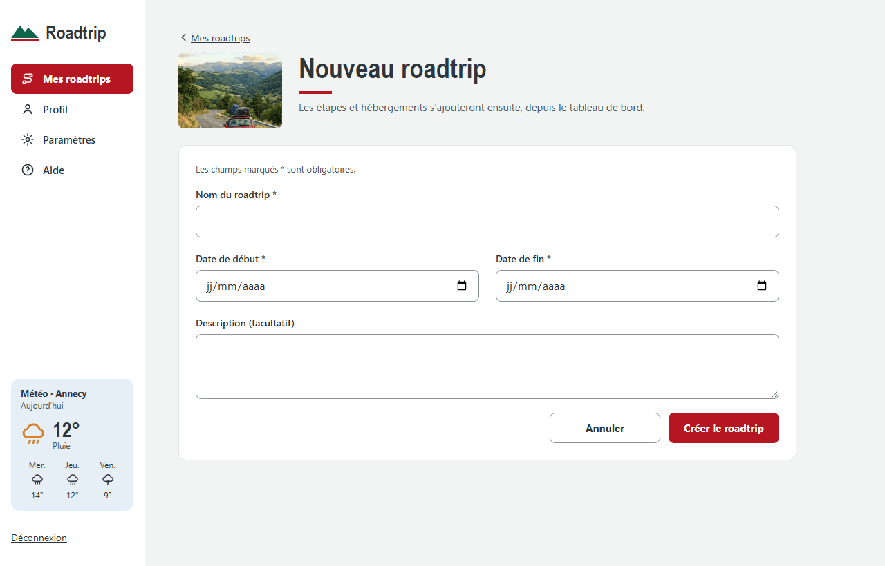

# Créer un roadtrip

Un **roadtrip** est votre voyage complet : un nom, une date de début et une date de fin. Les étapes et les hébergements s'ajoutent ensuite.

## Étapes

1. Sur **Mes roadtrips**, cliquez sur + Nouveau roadtrip
   (ou sur + Créer un roadtrip si la liste est vide).
2. Remplissez le formulaire **Nouveau roadtrip** :

    | Champ | Exemple | Règle |
    |---|---|---|
    | **Nom du roadtrip** | Alpes 2026 | Obligatoire, 80 caractères au plus. |
    | **Date de début** | 14/10/2026 | Obligatoire. |
    | **Date de fin** | 22/10/2026 | Le même jour ou après la date de début. 365 jours au plus. |
    | **Description** | Vacances d'automne en famille | Facultative, 500 caractères au plus. |

    Dès que les deux dates sont remplies, la **durée** s'affiche (par exemple « 9 jours »).

    { .capture loading=lazy }

3. Cliquez sur Créer le roadtrip.

Le message **« Roadtrip créé. »** apparaît et vous arrivez sur le **tableau de bord** du roadtrip, encore vide : **« Votre roadtrip est encore vide… »**.

La suite : [Ajouter une étape](ajouter-une-etape.md).

!!! tip "Pas encore sûr des dates ?"
    Mettez des dates approximatives : vous pourrez les [modifier plus tard](modifier-supprimer.md).

## Messages possibles

| Message | Explication |
|---|---|
| « Donnez un nom à votre roadtrip. » | Le nom est obligatoire. |
| « La date de fin doit être le même jour ou après la date de début. » | Les dates sont inversées. |
| « Un roadtrip dure au plus 365 jours. » | Le voyage est trop long. |
