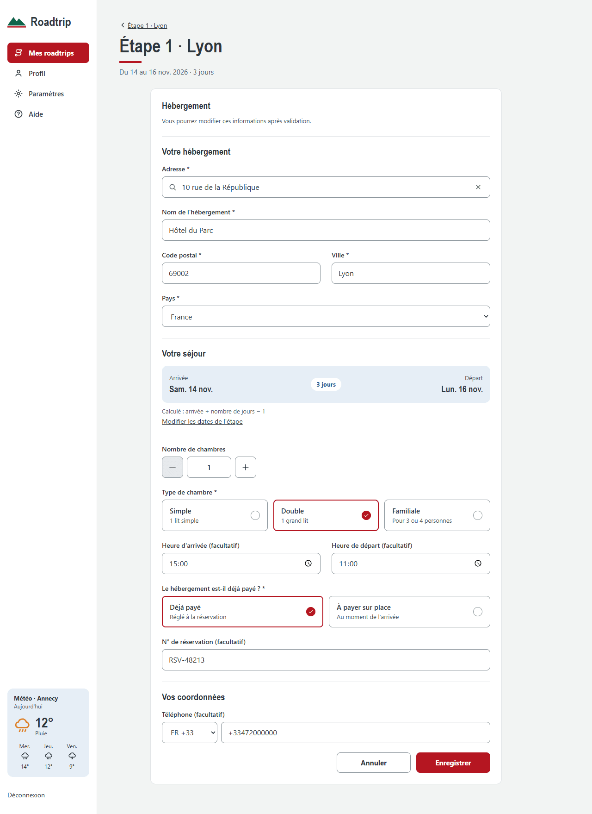
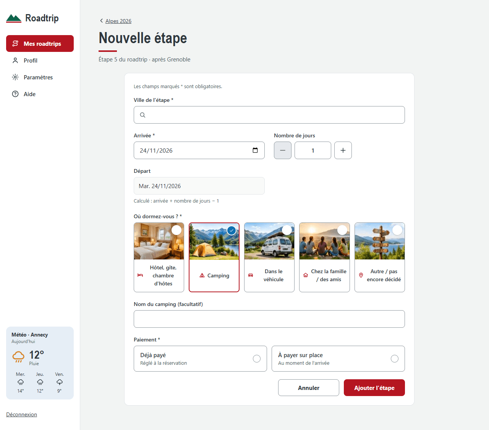

# Choisir où dormir

Pour chaque étape, vous indiquez où vous dormez dans **« Où dormez-vous ? »**. Voici ce que chaque choix vous demande.

## Hôtel, gîte, chambre d'hôtes

C'est un hébergement réservé. Après avoir choisi cette carte, cliquez sur Continuer vers l'hébergement : un second formulaire, **Hébergement**, s'ouvre.

**Votre hébergement**

- **Adresse** : tapez-la, puis choisissez une suggestion. Le code postal, la ville et le pays se remplissent tout seuls. Si aucune suggestion n'apparaît (« Adresse introuvable »), remplissez les champs vous-même.
- **Nom de l'hébergement**, **Code postal**, **Ville**, **Pays** : obligatoires pour un hôtel.

**Votre séjour**

- Les **dates** reprennent celles de l'étape. Pour les changer, utilisez le lien **Modifier les dates de l'étape**.
- **Nombre de chambres** (1 à 10) et **Type de chambre** :
    - *Simple* : 1 lit simple ;
    - *Double* : 1 grand lit ;
    - *Familiale* : pour 3 ou 4 personnes.
- **Heure d'arrivée** et **Heure de départ** : facultatives.
- **Paiement** : choisissez **Déjà payé** ou **À payer sur place**.
- **N° de réservation** : facultatif.

**Vos coordonnées**

- **Téléphone** : facultatif. Choisissez d'abord l'indicatif du pays.

{ .capture loading=lazy }

Terminez avec Enregistrer l'hébergement. Le message « Hébergement enregistré. » apparaît.

!!! tip "Vous n'avez pas encore réservé ?"
    Enregistrez l'étape sans remplir l'hébergement. Elle sera signalée **« sans hébergement »** sur le tableau de bord, pour ne pas l'oublier.

## Camping

Directement dans le formulaire de l'étape :

{ .capture loading=lazy }

- **Nom du camping** : facultatif.
- **Paiement** : choisissez **Déjà payé** (réglé à la réservation) ou **À payer sur place** (au moment de l'arrivée). Ce choix est obligatoire.

Vous pouvez compléter les détails plus tard depuis la page de l'étape avec + Ajouter un hébergement :

- adresse et téléphone ;
- emplacement : *Tente*, *Caravane*, *Camping-car* ou *Van* ;
- nombre de personnes (1 à 20).

## Dans le véhicule

Tout est facultatif :

- **Type de véhicule** : Voiture, Van aménagé, Camping-car ou Autre. Utile pour savoir si une aire de camping-car ou un parking suffit.
- **Lieu prévu** : par exemple « aire de camping-car du lac ».

## Chez la famille / des amis

Tout est facultatif :

- **Chez qui ?**
- **Adresse** : avec des suggestions.

## Autre / pas encore décidé

Aucune question supplémentaire. L'étape sera signalée **sans hébergement** jusqu'à ce que vous choisissiez un autre mode.

## Payé ou à payer ?

Pour l'hôtel et le camping, un **badge** sur l'étape indique où vous en êtes :

- **Payé** : rien à régler sur place ;
- **À payer** : vous paierez en arrivant.

Quand vous avez payé, ouvrez l'étape et cliquez sur Marquer comme payé.

!!! info "Pas de prix"
    L'application note seulement si c'est **payé** ou **à payer**. Elle n'enregistre pas les montants.

## Changer d'avis

Si vous changez le mode d'une étape qui avait déjà un hébergement (par exemple de l'hôtel vers le camping), l'application prévient : **« Supprimer l'hébergement ? »**.
L'ancien hébergement est alors supprimé.
