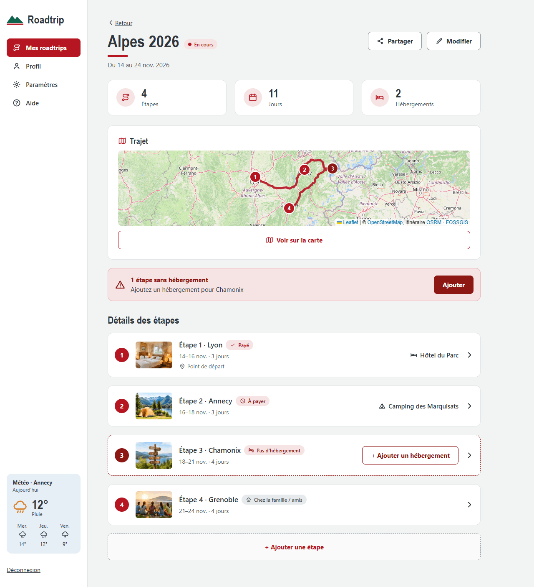
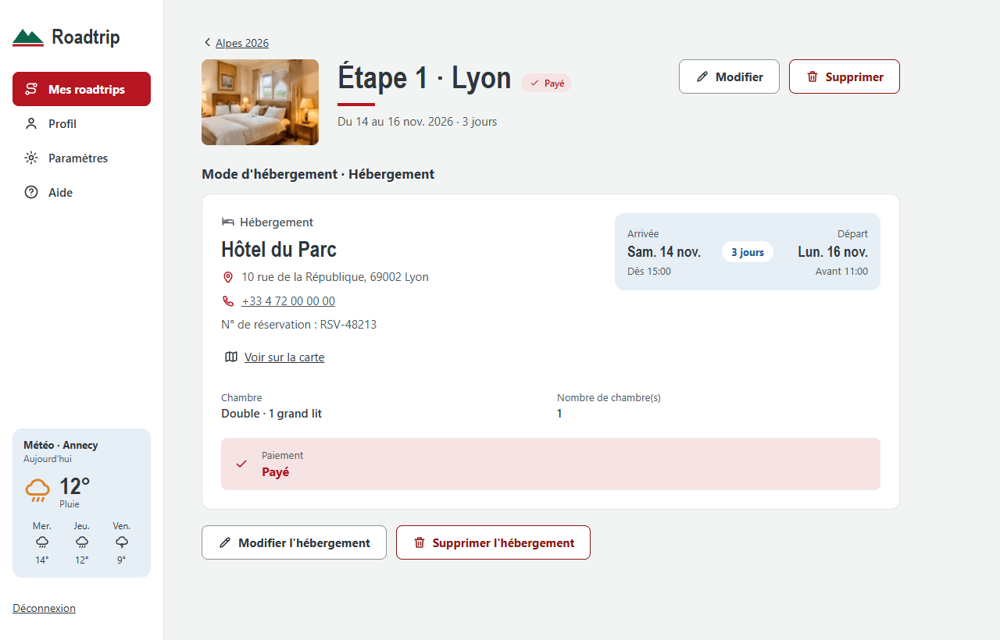
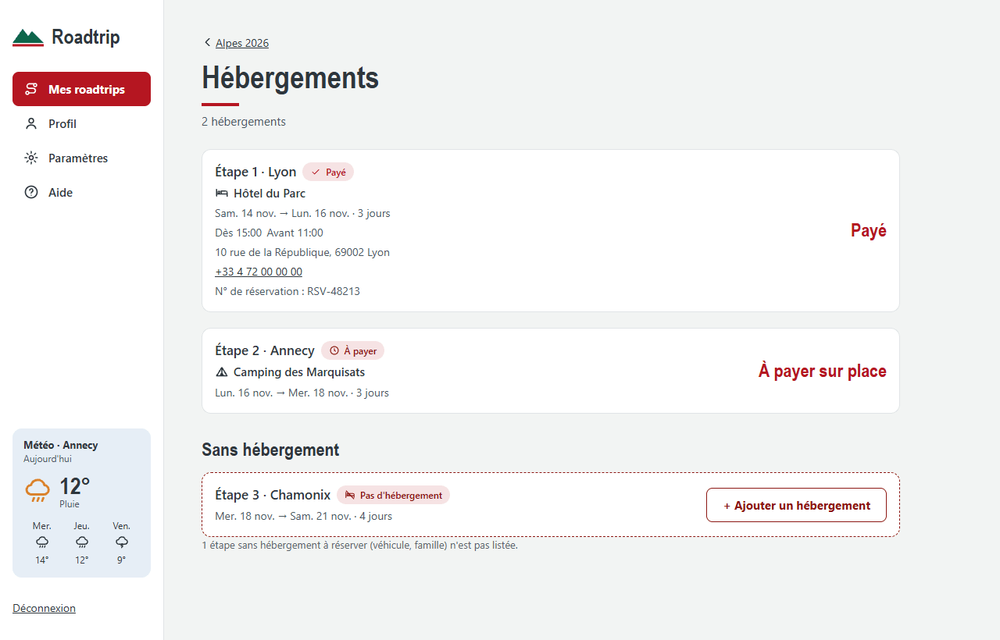

# Suivre le roadtrip

Quand vous ouvrez un roadtrip, vous arrivez sur son **tableau de bord**. Il résume tout le voyage.

{ .capture loading=lazy }

## En haut de la page

- Le **nom** du roadtrip, ses **dates** et son **statut** : *Brouillon*, *À venir*, *En cours* ou *Terminé*.
- Le bouton Partager, visible seulement par le propriétaire. Voir [Partager un roadtrip](../partage/partager.md).
- Le bouton Modifier, pour changer le nom ou les dates.

## Les trois chiffres clés

| Chiffre | Signification |
|---|---|
| **Étapes** | Nombre de villes du voyage. |
| **Jours** | Durée du roadtrip, de la date de début à la date de fin. |
| **Hébergements** | Nombre d'hôtels et de campings renseignés. Cliquez dessus pour ouvrir la **liste des hébergements**. |

## Le trajet

Une petite carte montre vos étapes. Cliquez sur Voir sur la carte pour l'agrandir. Voir [Voir le trajet sur la carte](carte.md).

## L'alerte « sans hébergement »

Si des étapes n'ont pas encore d'hébergement, un encadré l'indique, par exemple : **« 2 étapes sans hébergement — Ajoutez un hébergement pour Lyon et Nice »**.

Le bouton Ajouter vous emmène directement à la première étape à compléter.

Sont concernées :

- les étapes « Autre / pas encore décidé » ;
- les hôtels et campings dont l'hébergement n'est pas rempli.

## Le détail des étapes

Chaque étape apparaît sous forme de carte, dans l'ordre du voyage. Elle affiche :

- **« Étape N · Ville »** ;
- les **dates** et le nombre de jours ;
- un **badge** : *Payé*, *À payer*, *Pas d'hébergement*, *Dans le véhicule* ou *Chez la famille / amis*.

{ .capture loading=lazy }

La première étape porte la mention **Point de départ**. Cliquez sur une étape pour voir tous ses détails : adresse, téléphone, horaires, numéro de réservation, paiement.

En bas de la liste, + Ajouter une étape ajoute l'étape suivante.

## La liste des hébergements

{ .capture loading=lazy }

En cliquant sur le chiffre **Hébergements**, vous obtenez la liste de tous vos hôtels et campings. Pour chacun, elle affiche :

- les **dates** et les **horaires** (« Dès 15:00 », « Avant 11:00 ») ;
- l'**adresse** et le **téléphone** (cliquable sur téléphone) ;
- le **numéro de réservation** ;
- l'état du **paiement**.

Les étapes encore **sans hébergement** sont regroupées à la fin.

Les étapes « véhicule » et « famille » n'ont rien à réserver : elles ne figurent pas dans cette liste.
